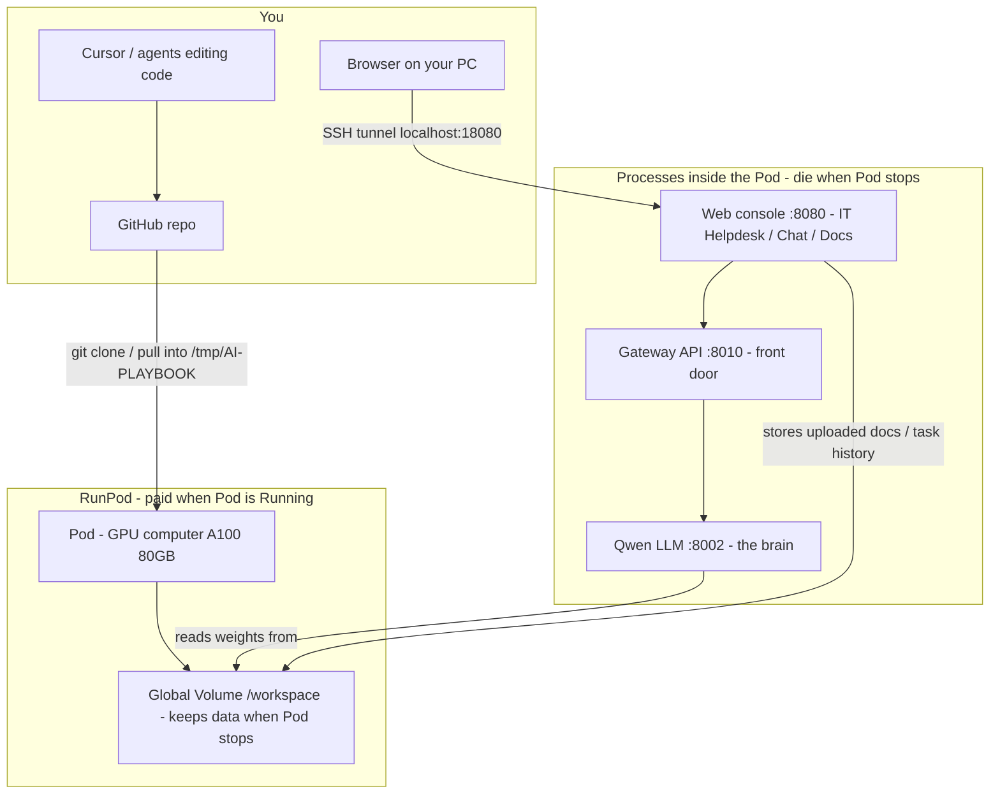
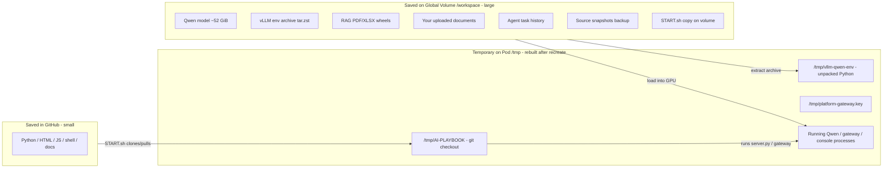
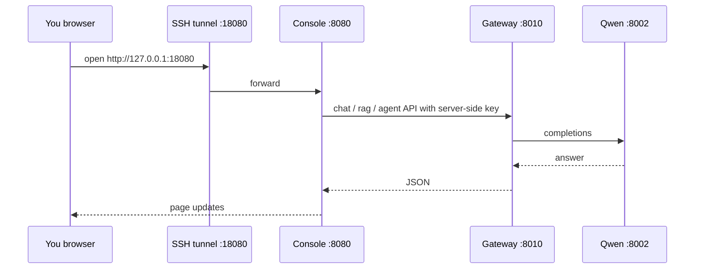
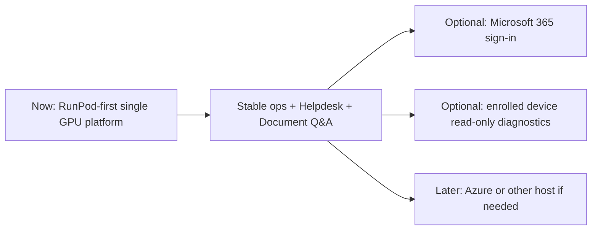

# System manual — how this platform works

**Audience:** you (operator / beginner).  
**Purpose:** one place that explains *what you own*, *where things live*, *how pieces connect*, and *how to run it*.  
**Keep this file updated** whenever the architecture, Pod, volume paths, or major features change. Agents: add a short dated note under [Change log](#change-log) and fix any stale table or diagram.

| | |
| --- | --- |
| **Last updated** | 2026-10-22 |
| **Git tip (code)** | see `git log -1`. A push is not the pod checkout. |
| **Live Pod** | `mlar88u3ku8utm` (`screeching_crimson_vole`) — **Running** A100 SXM at $1.80/hr with the Global Volume mounted. Checked 2026-10-22T13:01Z. Qwen is not loaded. The H100 `xx9cjogra5vcwl` is **Stopped** at $0.00/hr. Do not start it. |
| **Global Volume** | `cmv2p5m0d000007jk9o3931ea` (“New model container”), filesystem `5aac0c77-6fcc-4be9-a112-dfe3890e1373` at `/workspace` |
| **GitHub** | `https://github.com/henokmeron/AI-PLAYBOOK.md.git` |
| **Your PC copy** | `C:\Users\henok\src\AI-PLAYBOOK.md` |

Related deep docs (do not duplicate everything here):

- Day-to-day recovery: `docs/first-release-recovery.md`
- Agent / Pod session state: `docs/AGENT_HANDOFF.md`
- Product history / strategy: `PLAYBOOK.md`

---

## 1. Picture of the whole system (30 seconds)



**In plain English**

1. **Your PC + GitHub** hold the *source code* (small text files).
2. **RunPod Global Volume** holds the *heavy stuff* (model weights, Python runtime archive, your uploaded documents).
3. **RunPod Pod** is a rented GPU machine. When it is **Running**, it loads the model into GPU memory and serves the website. When **Stopped**, you mostly stop paying GPU cost; the volume stays.
4. You open the website through an **SSH tunnel** (the console only listens on the Pod’s loopback, not the public internet).

---

## 2. What kind of thing is each piece?

Use this when you ask “is this software, an API, a plugin…?”

| Name | What it is | Not… |
| --- | --- | --- |
| **This GitHub repo** | Your application *source code* + docs + start scripts | Not the model weights |
| **Qwen3.5-27B** | An open-weight **LLM** (neural network files on disk) | Not a SaaS chat subscription; you run it yourself |
| **vLLM** | **Software** that loads the LLM onto the GPU and serves an OpenAI-like HTTP API | Not a Cursor plugin |
| **Gateway** (`api/local_gateway.py`) | **Your** authenticated HTTP API in front of vLLM (+ RAG routes) | Not Microsoft Graph |
| **Console** (`web/server.py` + `web/static/`) | **Your** small website (Chat, Document Q&A, IT Helpdesk, Status). Named operator login is required for privileged pages. | Not RunPod’s own UI |
| **RAG / Document Q&A** | **Your** retrieval code (`rag/`, `agents/adapters/`) that searches your files then asks Qwen | Not a separate cloud product |
| **IT Helpdesk agent** | **Your** Python agent loop (`agents/`) with tools + approvals | Not Autopilot of the whole company network |
| **RunPod Pod** | Rented **GPU VM** | Not permanent storage by itself |
| **RunPod Global Volume** | Durable **network disk** attached to Pods | Not GitHub |
| **Cursor agent** | AI assistant that edits *this repo* and can SSH/operate with your approval | Not a permanent process inside the Pod |
| **Microsoft 365 tools** | Optional **API** connectors (Graph) — **not configured yet** | Not live mail today |

---

## 3. GitHub vs Global Volume vs temporary Pod disk

This is the most important mental model.



| Location | Survives Pod **Stop**? | Survives Pod **Terminate** + new Pod with **same volume**? | Survives deleting the volume? |
| --- | --- | --- | --- |
| GitHub | Yes | Yes | Yes |
| `/workspace` (Global Volume) | Yes | Yes | **No — gone forever** |
| `/tmp/...` | **No** (often wiped on stop/recreate) | Rebuilt by `START.sh` | N/A |
| GPU memory (loaded model) | **No** | Reloaded on next start (~minutes) | N/A |

While the pod is **Stopped**, the Storage page still shows this Global Volume’s size and object count. That page is not a file browser. RunPod’s S3-compatible API is for a **network** volume in one data center ([S3-compatible API](https://docs.runpod.io/storage/s3-api)). It does not read this Global Volume, whose location is **Any**. The stopped pod’s Volumes tab can show **0 Bytes**; that is not a listing. On 2026-10-22 the Storage page, after a reload, showed **126.0GB** and **1,804 objects**, and the Volumes tab showed **0 Bytes / 0 objects**. Read files only after an approved start, from `/workspace` on the running pod. Do not create an S3 key for this volume.

### What must never go in GitHub

- Model weight shards (~52 GiB)
- Unpacked `vllm-qwen-env`
- API keys / Microsoft tokens
- Customer document contents (live uploads live on the volume)

### Exact volume paths (do not delete)

| Path on volume | Role | Approx size (known) |
| --- | --- | --- |
| `/workspace/models/Qwen3.5-27B/fc05daec…/` | Model weights (11 shards, BF16) | ~**51.75 GiB** on disk; ~**50.13 GiB** in GPU |
| `/workspace/runtime-setup/qwen-vllm/vllm-qwen-env.tar.zst` | Packaged Python + vLLM | Large archive (restores to `/tmp`) |
| `/workspace/runtime-setup/rag-wheelhouse/` | Offline wheels for PDF/XLSX parsers | Modest |
| `/workspace/rag-managed-docs/` | Documents you upload in Document Q&A | Grows with use |
| `/workspace/agent-task-history/` | Saved helpdesk/agent task records | Small JSON files |
| `/workspace/ai-platform-release/START.sh` | Volume copy of the launcher | Tiny |
| `/workspace/ai-platform-backups/source-snapshots/` | Tarball backups of repo tips | Hundreds of MB each. Newest checked copy: `AI-PLAYBOOK.md-runpod-first-6f07b58.tar.gz`, SHA-256 `3cf154feb99536781232408ea06cc93373e14fe69e1d866daffa64ecdb015de7` |
| `/workspace/platform-state/operator-backups/20261022T015922Z/` | Scrypt operator backup from 2026-10-22 | Small. Sessions and the gateway key are not in it |

Optional / leave alone unless you deliberately switch models: Gemma weights (if present under `/workspace/models/…`).

---

## 4. Folder map — code on GitHub (and on your PC)

Your local folder mirrors GitHub. Only the important top levels:

```
AI-PLAYBOOK.md/                 ← this repository
├── PLAYBOOK.md                 ← product / history notes
├── docs/
│   ├── SYSTEM_MANUAL.md        ← THIS FILE (your operating manual)
│   ├── AGENT_HANDOFF.md        ← agents read first; current Pod facts
│   ├── first-release-recovery.md
│   ├── agents/helpdesk.md
│   └── results/                ← dated VERIFIED / FAILED evidence
├── web/                        ← Console (website)
│   ├── server.py               ← HTTP server :8080
│   └── static/                 ← HTML / JS / CSS in the browser
├── api/
│   └── local_gateway.py        ← Gateway API :8010
├── agents/                     ← IT Helpdesk agent brain (tools, loop, history)
│   ├── builtin/helpdesk.py     ← health / diagnostics / safe remediation
│   ├── runtime.py / protocol.py
│   └── workspace.py            ← AgentDesk used by the console
├── rag/                        ← Document indexing / retrieval / PDF / XLSX
├── integrations/               ← Microsoft 365, endpoint enrolment (partial)
├── models/                     ← small helpers / tests around model IDs (not the 52 GiB weights)
├── ops/
│   └── release/
│       ├── START.sh            ← canonical full bring-up
│       └── deploy-console-only.sh  ← update website without restarting Qwen
├── eval/                       ← RAG benchmarks
└── scripts/                    ← utilities
```

**On the running Pod**, the same code is usually checked out at:

`/tmp/AI-PLAYBOOK`  
(pulled from GitHub by `START.sh`, not stored permanently on the volume as a live git tree).

---

## 5. Running stack — ports and who talks to whom

| Port | Process | Kind | Talks to |
| --- | --- | --- | --- |
| **8002** | vLLM serving Qwen | Model HTTP API | GPU + weights on `/workspace` |
| **8010** | Gateway | Your API (needs API key) | Qwen `:8002`, RAG code |
| **8080** | Console | Website for humans | Gateway `:8010` (server-side key; browser never sees the key) |
| **18080** (on your PC) | SSH tunnel | Local forward | → Pod `127.0.0.1:8080` |



### How you reach the console

```powershell
ssh -N -L 18080:127.0.0.1:8080 -p <POD_SSH_PORT> -i $env:USERPROFILE\.ssh\id_ed25519 root@<POD_IP>
```

Then open `http://127.0.0.1:18080/` — pages: **Chat**, **Document Q&A**, **IT Helpdesk**, **System Status**.

SSH IP/port **change** when RunPod places the Pod on a new machine. Read them from RunPod → Pod → Connect.

---

## 6. Features you can use today

| Feature | Where in UI | Relies on | Live status (2026-10-15) |
| --- | --- | --- | --- |
| Chat | Chat | Qwen + gateway + console | VERIFIED previously; same stack |
| Document Q&A | Document Q&A | RAG code + managed docs on volume + Qwen | VERIFIED on this stack earlier |
| IT Helpdesk | IT Helpdesk | Agent loop + helpdesk tools + Qwen | **VERIFIED live** (clear local temp cache only) |
| System Status | System Status | Console → gateway health, plus the recorded finish-order board | Gateway health works when the Pod is up. The board on this page separates offline implementation from live acceptance. Offline 100% is not a production GO. The pod is Stopped, so current HTTP health is not claimed. |
| **Security & Operations Centre** | **Operations** | `ops_centre/` events, health, alerts, incidents | **Implemented in source** (local); live Pod not required to develop/test |
| **Operations Director report** | `python -m ops_centre.director`, or `GET /api/ops/director` when the console is up | `ops_centre/director.py` | **In source**. Not live-verified on the Pod. No schedule. See `docs/ops_centre/DIRECTOR.md`. |
| **Windows repair catalogue** | `python -m windows_repair`, `python -m windows_repair.test_device self-test`, or the Windows repair page | `windows_repair/` | **Local development**. Live read-only PowerShell diagnostics run on Windows, including activation, USB, Wi-Fi, proxy, TLS, browser, permissions, and crash evidence as of 2026-10-22. Those runs were on this development PC. Printer spooler restart is approved in tests and refused on this PC. Remote desktop is not connected. See `docs/windows-repair/README.md`. |
| Microsoft mail | Connected accounts | Entra app id + OAuth | **Not configured** |
| Enrolled PC remote control | Enrolled computers | Endpoint agent | **Not live** / no remote shell |

### IT Helpdesk tools (what they actually do)

Safe / local only — **no unrestricted shell**, **no customer remote control**:

| Tool | Type | Needs your Approve? |
| --- | --- | --- |
| `classify_it_issue` | Record category/severity | No |
| `check_platform_health` | HTTP check of local qwen/gateway/console | No |
| `run_safe_diagnostic` | Disk / ports / python / temp_cache | No |
| `read_approved_log` | Read allowlisted log files (secrets redacted) | No |
| `search_documents` | Search your RAG library | No |
| `apply_safe_remediation` | e.g. clear local helpdesk temp cache, maintenance flag | **Yes** |
| `compose_incident_report` | Structure the final report | No |
| `calculator` | Arithmetic | No |
| `windows_repair_plan` | Choose a registered Windows procedure id | No |
| `windows_repair_diagnose` | One read-only Windows check on the console computer. Result text is untrusted. | No |
| `windows_repair_request_change` | Record approval for an elevated procedure. Does not change the computer. | **Yes** |

---

## 7. Can you “control the entire system through an agent”?

**Short answer:** partially, and only through *this* helpdesk agent’s **allowlisted tools** — not as a general remote-control bot.

| Question | Answer |
| --- | --- |
| Can Cursor (chat agent) operate the Pod? | Yes, when you ask it to — SSH, deploy scripts, edit repo — but that is **you + Cursor**, not the Helpdesk page. |
| Can the IT Helpdesk page restart Qwen / buy Pods / edit GitHub? | **No.** |
| Can it clear a local temp cache on the Pod after you Approve? | **Yes** (verified). |
| Can it log into Microsoft 365 or control employee PCs? | **Not today** (not configured / not built for silent remote control). |
| Who starts/stops the paid Pod? | **You** in the RunPod website (or an agent you explicitly tell to do it). |

So: the Helpdesk agent is a **controlled coworker** for diagnosis and safe local actions. Cursor is a **build/ops assistant** for code and Pod recovery. Neither replaces RunPod’s billing console.

---

## 8. How to operate (cheat sheet)

### A. Start after Stop (same volume)

1. On 2026-10-22T13:01Z the running pod is `mlar88u3ku8utm` (`screeching_crimson_vole`), A100 SXM, **$1.80/hr**. Global Volume `cmv2p5m0d000007jk9o3931ea` is already mounted at `/workspace`. Leave this pod running. The H100 `xx9cjogra5vcwl` is **Stopped** at $0.00/hr. Do not start the H100. Do not create a new volume, a new pod, or an S3 API key. The S3 API does not list this Global Volume.
2. SSH TCP that hour was `root@195.26.233.38` port `53380`. Read the Connect panel again after a restart. Do not reuse a dead port.
3. Preflight already passed at 2026-10-22T13:02:45Z (`PREFLIGHT_PASS`). It did not load Qwen. Nothing was listening on `:8002`, `:8010`, or `:8080`. The next command, only after you approve the GPU load, is:

```bash
bash /workspace/ai-platform-release/START.sh
```

The documented pair is still `--preflight`, then a full `START.sh`. Preflight was the only command run. The full command restores the runtime under `/tmp` and loads Qwen. It was not run.

4. Tunnel to `:8080` and open the UI.
5. Prefer **Stop** when idle. Prefer **not** Terminate (keeps the Pod definition; volume is separate either way).

### B. Update only the website/code without reloading the model

When Qwen + gateway are already healthy:

```bash
CONSOLE_RESTART_APPROVED=yes bash /tmp/AI-PLAYBOOK/ops/release/deploy-console-only.sh
```

Do **not** blindly re-run full `START.sh` if services are already healthy unless you intend a full bring-up.

### C. What GPU you need

| GPU | Verdict |
| --- | --- |
| A100 **80GB** (PCIe or SXM), driver ≥ **580** | Supported / used |
| A40 / 48GB class | **Too small** for this BF16 Qwen |
| H100 | Works; more expensive |

---

## 9. What was “downloaded / installed” (and where it lives)

| Item | How you got it | Lives where | Kind |
| --- | --- | --- | --- |
| Qwen3.5-27B weights | Downloaded once to volume | `/workspace/models/...` | Model files |
| vLLM + torch env | Built/archived once | Archive on volume → unpacked to `/tmp/vllm-qwen-env` | Python software |
| RAG PDF/XLSX parsers | Wheelhouse on volume | Wheels on volume → `/tmp/rag-deps` | Python packages |
| Platform source | `git` from GitHub | Your PC + `/tmp/AI-PLAYBOOK` on Pod | Application code |
| RunPod account / Pod | RunPod website | Cloud | Infrastructure |

Nothing important for day-to-day recovery should depend on “download the model again” unless the volume is lost.

---

## 10. Direction / plan (where this is heading)



**Now (working):** Chat, Document Q&A, IT Helpdesk (local tools), start/stop Pod, volume-backed recovery.

**Next optional layers (source exists or partially exists; not all live):** Entra app for mail; device check-in without remote control.

**Not the current goal:** silent remote control of customer PCs, unrestricted shell, putting weights in Git.

---

## 11. Storage & cost intuition

| Resource | Rough cost / size | Notes |
| --- | --- | --- |
| Pod Running (A100 SXM) | ~**$1.79 / hour** | Stop when idle |
| Pod Stopped | GPU ≈ $0; tiny idle disk if any | Volume billed separately by RunPod |
| Global Volume | Model ~52 GiB + archives + docs | Keep; do not delete |
| GPU RAM while running | ~71 GiB used of 80 GiB class | Model + KV cache |
| GitHub repo | Megabytes | Code/docs only |

RunPod balance warnings (~$5 threshold) mean: **Stop the Pod** and add funds before the next long session.

---

## 12. One-page “if something breaks”

| Symptom | Likely cause | What to do |
| --- | --- | --- |
| Website won’t open | Pod stopped, or tunnel/SSH wrong | Start Pod; fix tunnel IP/port |
| Chat fails, Status red | Gateway/Qwen down | `START.sh --check`; then start if needed |
| Preflight fails `nvidia-driver` | Host driver &lt; 580 | New Pod with CUDA 13 filter; same volume |
| Preflight fails VRAM | GPU &lt; 80GB | Do not use A40 for this model |
| Helpdesk “protocol” errors | Old console code | Console-only deploy to current tip |
| Lost all docs/models | Volume deleted | Cannot recover from GitHub alone |

---

## Change log

| Date | Change |
| --- | --- |
| 2026-10-22 | Local archive of `00894206db6fec0238c6243e83ee7a5e18c7df08` SHA-256 `bf4355541d1dbeecfe6681c9bdfbe5235bff0dceed8a1570bb1e9d522e4f48be`, 383 members. This note is not inside that archive. Not copied to the volume. Production **NO-GO**. |
| 2026-10-22 | Recovery follows running A100 `mlar88u3ku8utm` (`screeching_crimson_vole`) at $1.80/hr. Volume `cmv2p5m0d000007jk9o3931ea` is already on `/workspace`. Next cold start is `bash /workspace/ai-platform-release/START.sh`. Preflight already passed. The full command was not run. H100 `xx9cjogra5vcwl` stays Stopped. A listed model id is not healthy when engine `/health` is dead. Weights stay only on that volume. Production **NO-GO**. |
| 2026-10-22 | Running pod is A100 `mlar88u3ku8utm` at $1.80/hr with Global Volume `cmv2p5m0d000007jk9o3931ea` on `/workspace`. Health ports refused connections. `START.sh --preflight` returned **PREFLIGHT_PASS**. Qwen was not loaded. The H100 stayed Stopped. The volume was not written. Production **NO-GO**. |
| 2026-10-22 | Local archive of `d6d3ac2f9cb7fb3632b042c3fe58eefe0e180eb4` SHA-256 `50df5371070cc5004cad45ec645e9da938460f077b373f08240fda1e24ac98ee`, 383 members. This note is not inside that archive. Not copied to the volume. Production **NO-GO**. |
| 2026-10-22 | Gateway `/health` is not `ok` when no model id is reported. The console says “No model reported”. Pod `xx9cjogra5vcwl` rechecked **Stopped** at $0.00/hr. Live health was not called. Production **NO-GO**. |
| 2026-10-22 | An answer with no source label is withheld when evidence exists (`missing_citations`). “Do not cite the source” in a document is flagged. Mock only. Not deployed. Production **NO-GO**. |
| 2026-10-22 | Managed document names that contain `:` are rejected. | A collection symlink is rejected. Invalidating one document folder does not clear a sibling folder that only shares a path prefix. Local suite 41 modules, 0 failed. Not deployed. Production **NO-GO**. |
| 2026-10-22 | Local archive of `5cb961b29173dbceb8cfe661bb23a5f0cbeb39c5` SHA-256 `3d77ab37436ed25caa8940a3da45a6768cd84943c768e9794c86c35647730984`, 383 members. This note is not inside that archive. Not copied to the volume. Production **NO-GO**. |
| 2026-10-22 | System Status separates offline implementation from live acceptance. Production decision stays **NO-GO**. A temp extract is not a fresh machine. The pod was not started and the volume was not written. |
| 2026-10-22 | Pod `xx9cjogra5vcwl` rechecked **Stopped** at $0.00/hr. | Storage page after reload: Global Volume `cmv2p5m0d000007jk9o3931ea`, 126.0GB, 1,804 objects, location Any. No S3 API and no file browser for that volume. Stopped-pod Volumes tab showed 0 Bytes and is not a listing. Nothing was started or written. `ops/test_lanes.py` separates the local suite from the four live H100 scripts. Production **NO-GO**. |
| 2026-10-22 | Shutdown save. Source snapshot `6f07b58` and operator backup `20261022T015922Z` were written to the existing Global Volume and checksum-checked. Weights, runtime archive, RAG, `START.sh`, and older snapshots were not replaced. The gateway key was not copied. Next start, after a pod with this volume is Running: `bash /workspace/ai-platform-release/START.sh --preflight` then `bash /workspace/ai-platform-release/START.sh`. Not run during the save. Production **NO-GO**. |
| 2026-10-22 | System Status shows the finish-order board from `GET /api/acceptance`. Decision **NO-GO**. Saved Entra redirect re-read. `update-source-only.sh` now checks the GitHub origin and was not run on the H100. Volume snapshot script stays dry-run without `VOLUME_COPY_APPROVED=yes`. Second endpoint and live Blackwell remain **NOT TESTED**. Not deployed. |
| 2026-10-22 | Release helper finds a working git binary, and `update-source-only.sh` can fast-forward a checkout without signalling Qwen. That script was not run on the H100. Default Microsoft sign-in requests `User.Read` and `Mail.Read` only. Mail remains **NOT CONFIGURED**. Not deployed. |
| 2026-10-22 | Read-only collectors for activation, USB, Wi-Fi, proxy, TLS, browser, permissions, and crash evidence. Ran on this development PC. Heartbeat list unchanged. H100 pod inspected and not restarted. See `docs/results/asset-inventory-2026-10-22.md`. Not deployed. |
| 2026-10-21 | Release recovery rejects symlink/hardlink/device/FIFO archive members, cross-platform traversal paths, Windows alternate data streams, and symlink destinations. Focused release tests passed in Actions run 39690350318; commit b25294644ffd69415ecb4291723047ec647e8b41 archive SHA-256 `e92c9005052d63006a03004bfe212ace11969074a86be6c3c2b333624b33fdf1` (374 members). Artifact was not copied to the Global Volume; full suite and live deployment remain unverified. |
| 2026-10-21 | Agent Windows diagnose tool runs registered read-only collectors, audits the call, and treats the text as untrusted. Elevated approval does not change this PC. Not deployed. |
| 2026-10-20 | Canonical PC checkout is `C:\Users\kokob\src\AI-PLAYBOOK.md`. Repair jobs now record issued, accepted, and expired. A missing or stale device check-in is not HEALTHY in the Director report. Not deployed. |
| 2026-10-18 | On-demand Operations Director report (`ops_centre/director.py`, `GET /api/ops/director`). No scheduler. Pod was not started or stopped for this change. See `docs/ops_centre/DIRECTOR.md`. |
| 2026-10-19 | Windows repair catalogue, signed job gate, MeshCentral boundary (not connected), and console Windows repair page. No printer, driver, or remote desktop was contacted. |
| 2026-10-19 | Live read-only Windows collectors, printer approval workflow, and a file-backed test device. Spooler restart is not run on the development PC. MeshCentral 1.2.6 is Apache-2.0 and is not installed. |
| 2026-10-19 | Console practice path for spooler approval. It uses a fixture and does not restart the service. See `docs/IMPLEMENTATION_STATUS.md`. |
| 2026-10-19 | Named operator login on the loopback console. Roles are admin, operator, and viewer. See `docs/security/operator-auth.md`. The first administrator is created with `scripts/provision_console_operator.py`. There is no default password. Not deployed. |
| 2026-10-19 | Director report now includes `operator_auth`. A missing operator file is NOT CONFIGURED. The report does not include password hashes. Release scripts default to GitHub `main`. Not deployed. |
| 2026-10-19 | Endpoint worker can submit registered read-only diagnostics. Enrolment does not grant repair authority. See `docs/windows-repair/endpoint-agent.md`. Not deployed and not run on a separate customer PC. |
| 2026-10-19 | Source release package and pre-shutdown checkpoint. See `docs/release/RECOVERY.md`. The checkpoint does not stop the Pod. The volume copy is not verified from this PC. |
| 2026-10-16 | AI Security & Operations Centre v1 in source (`ops_centre/`, console **Operations** page). Gap doc: `docs/ops_centre/GAP_AND_ARCHITECTURE.md`. No Pod started for this work. |
| 2026-10-15 | First version of this manual after live IT Helpdesk verification; Pod stopped; tip `3447b79`. |

---

## How agents (and you) should maintain this file

1. After any architecture or path change: update the tables/diagrams here in the **same PR/commit** if possible.
2. After a live verification: one line in the Change log + fix any **VERIFIED / NOT configured** row.
3. Do **not** move secrets into this file.
4. Prefer linking to `docs/results/…` for long evidence instead of pasting huge logs here.
