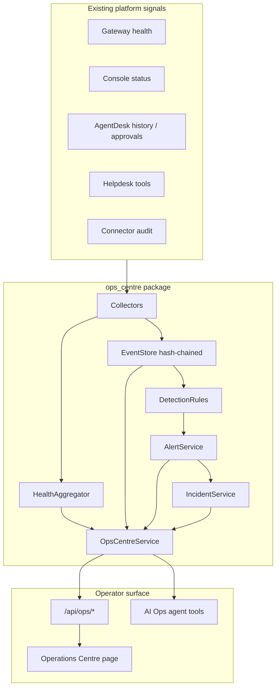

# AI Security & Operations Centre — Gap assessment and architecture

**Date:** 2026-10-16  
**Scope:** Local-first implementation in this repository. **No RunPod Pod start**, no new cloud infrastructure, no model re-download.  
**Git tip at start of work:** `002002d` (verify with `git log -1`).

---

## 1. Existing capabilities (reuse)

| Area | What exists | Reuse how |
| --- | --- | --- |
| Health | Gateway `/livez`, `/readyz`, `/health`; console `/api/status`; helpdesk `check_platform_health` | Independent probe layer + executive tiles |
| Audit | `integrations/audit.py` hash-chained connector log; `agents/trace.py`; `TaskHistoryStore` | Generalise event store with same chain pattern |
| Redaction | `agents/redaction.py`, console `scrub` | All SOC views pass through redaction |
| Approvals | Agent + `ApprovalService` | Consequential SOC remediation stays approval-gated |
| Agent runtime | `agents/runtime.py`, tool registry, protocol | AI Ops agent = new allowlisted tools, not a new loop |
| Console | Chat / Docs / Helpdesk / Status | Add **Operations** view; do not fork a second app |
| Tenancy types | `integrations/tenancy.py` | `tenant_id` on every event (default `local-console`) |
| Security review | `docs/security/baseline-review.md` | Threat backlog; do not claim compliance |

## 2. Missing capabilities (build)

| Gap | Risk if ignored | v1 approach |
| --- | --- | --- |
| No central event timeline | Blind to cross-component activity | `ops_centre` event store + collectors |
| No alert lifecycle | Operators only see ad-hoc failures | Alerts with new→ack→investigate→resolve |
| No security incident object | Helpdesk “incident” ≠ security IR | Separate `SecurityIncident` schema |
| No detection rules | No systematic suspicious-pattern checks | Explicit rule engine on ingested events |
| No ops dashboard | Status page is a single gateway probe | Operations Centre UI |
| No AI ops agent tools | Manual log diving only | Allowlisted read tools + report compose |
| Weak console auth | Anyone with tunnel reaches UI | **Documented; not “fixed” by pretending**; SOC stays loopback |
| No SIEM export / paging | No external notify yet | In-dashboard feed + notification adapter stubs |
| No continuous metrics stack | No Prometheus/OTel | Bounded local probes only in v1 |

## 3. Risks

1. **False green:** Showing “healthy” without a fresh probe. Mitigation: every status includes `verified_at` and `verification` (`observed` \| `unknown` \| `inferred`).
2. **SOC depends on Qwen:** If monitoring dies when the model dies, it is useless. Mitigation: health aggregator uses HTTP probes only; AI agent is optional.
3. **Log injection / prompt injection:** Untrusted event text must never grant tools. Mitigation: tools are code-gated; prompts treat telemetry as data.
4. **Tamper claims:** Hash chaining detects *silent rewrite of the chain we control*; it is **not** forensic-grade against root on the host. Document that honestly.
5. **Scope creep into invasive monitoring:** No endpoint spyware; only platform-owned signals.

## 4. Proposed architecture (v1)

**Storage:** JSONL under configurable dir (`OPS_CENTRE_DIR`, default `/tmp/ops-centre` locally or `/workspace/ops-centre` when volume writable).  
**Integrity:** per-stream hash chain + `verify_chain`; not WORM cloud storage.  
**AI agent:** diagnoses and recommends; remediation requires existing approval pattern.

## 5. What v1 will and will not claim

| Claim | v1 |
| --- | --- |
| Central ops dashboard in console | Yes |
| Timeline of observed platform events | Yes (collected + synthetic probe events labelled) |
| Alert + incident lifecycle | Yes |
| Detection rules with evidence | Yes (initial rule pack) |
| External email/Slack notify | Adapter interface only unless credentials configured |
| Multi-customer SaaS tenancy UI | Schema fields only (`tenant_id`) |
| Detects all attacks | **No** — coverage and blind spots documented |
| Forensic-grade tamper resistance | **No** — hash chain only |
| Starts RunPod / loads Qwen | **No** without operator approval |

## 6. Implementation order

1. `ops_centre` core library + unit tests  
2. Wire collectors into console process  
3. `/api/ops/*` + Operations UI  
4. AI Ops allowlisted tools + docs  
5. Update `SYSTEM_MANUAL.md` / handoff  

---

*This document is the gap assessment requested before implementation. Implementation follows in-repo under `ops_centre/` and `web/`.*
