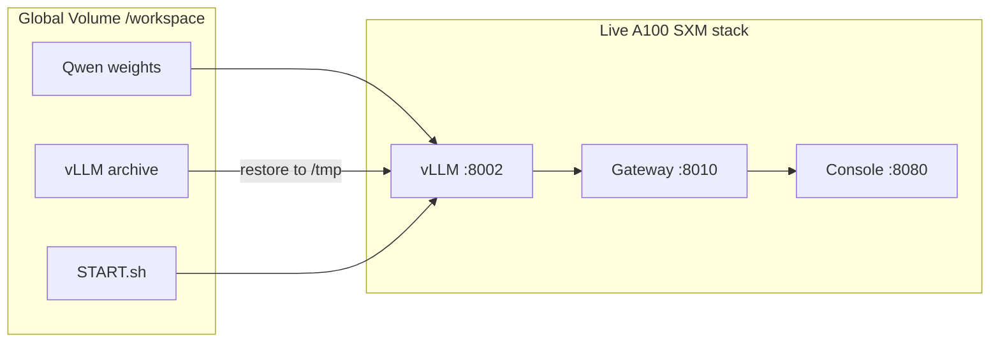

# Qwen integration status (honest answer) — 2026-10-14

**Short answer: yes for the RunPod-first platform path — Qwen is the production default on the live stack.**

An earlier note (2026-10-13) described an *isolated-only* stack with Gemma still as production. That is obsolete. This file is the current status. The Cursor plan file that still describes the old state was left unchanged on purpose.

## What is working right now

- **Model weights** on the persistent Global Volume at  
  `/workspace/models/Qwen3.5-27B/fc05daec18b0a78c049392ed2e771dde82bdf654`  
  (11 shards, BF16, no quantization). Survive Pod stop/restart while volume `5aac0c77-…` / UI name “New model container” stays attached.
- **vLLM runtime archive** on the volume at `/workspace/runtime-setup/qwen-vllm/`  
  (`vllm-qwen-env.tar.zst` + `SHA256SUMS` — **VERIFIED** with `sha256sum -c` from that directory on 2026-10-14). Extracted copy runs from `/tmp/vllm-qwen-env` (ephemeral by design).
- **Production registry:** `models/registry.yaml` has `production: qwen3.5-27b` and `defaults.active_model_id: qwen3.5-27b`. Gemma remains `selection_eligible` and returns **HTTP 409** while Qwen owns the GPU.
- **Main platform ports on the current A100 SXM Pod** (`3s3mh10hrkhocw`, $1.79/hr):
  - Inference: `127.0.0.1:8002` (Qwen)
  - Gateway: `127.0.0.1:8010`
  - Console: `127.0.0.1:8080`
  - All three returned HTTP 200 when last checked; chat E2E, text/PDF/XLSX Document Q&A, and console UI chat (`UI_OK`) **VERIFIED**.
- **Source snapshot** for commit `0b49946`:  
  `/workspace/ai-platform-backups/source-snapshots/AI-PLAYBOOK.md-runpod-first-0b49946.tar.gz`  
  SHA-256 `4e718a05ac59397658a1b7b21b701f4ad2dde1407b3ace89f37446e6187fe620` — **VERIFIED**.
- **Git:** branch `feature/qwen3.5-27b-integration` at `0b49946` (also tip of `feature/qwen-a100-start-hardening`). `main` not merged.

## Persistence checklist

| Item | Persistent on Global Volume? |
| --- | --- |
| Qwen model weights | **Yes** |
| Smoke/evidence under `/workspace/platform-diagnostics/` | **Yes** |
| Source snapshots + checksum manifests | **Yes** (`0b49946` and earlier) |
| vLLM Python env *archive* | **Yes** (`/workspace/runtime-setup/qwen-vllm/`) |
| Extracted vLLM env | **No** (rebuilds to `/tmp` via `START.sh`) |
| Production gateway wired to Qwen | **Yes** on the current A100 Pod (`:8010` → `:8002`) |
| RAG managed docs | **Yes** (`/workspace/rag-managed-docs`) |

## GPU reality (do not assume from price)

| GPU | Fits this BF16 Qwen? |
| --- | --- |
| A40 / RTX A6000 / L40S (~48 GB) | **No.** Weights alone ~50 GiB on GPU. A40 measured 46,068 MiB. |
| A100 80GB SXM (current) | **Yes — VERIFIED** cold start + E2E. |
| H100 NVL | Previously proven; costlier. |

Driver must be **≥580**. Use RunPod’s CUDA 13 filter.

## Known recovery footgun

Fresh Pods that clone published `0b49946` without the `PATH` fix can fail FlashInfer JIT with **`ninja` not found**. The archived env ships `bin/ninja`; it must be on `PATH` when starting vLLM. Fix lives in `ops/start-first-release.sh` (`PATH="$QWEN_ENV/bin:..."`). Confirm it is **committed, pushed, and installed** into `/workspace/ai-platform-release/` before relying on a brand-new Pod clone. Workaround:  
`PATH=/tmp/vllm-qwen-env/bin:$PATH bash /workspace/ai-platform-release/START.sh`.

## What is still not done / deferred

- Merge to `main`: **not done** (needs approval).
- Gemma restored as the live GPU model: **not done** (one GPU; Qwen is intentional default).
- Nginx `0.0.0.0:8081` exposure / login: **deferred by owner** until a later auth phase.
- Context length &gt; 8192 on A100: **NOT TESTED**.
- Azure resources: **not created**; Azure remains optional.

## Bottom line

You have a **working RunPod-first Qwen platform**: weights and runtime archive on the Global Volume, Qwen as registry production default, and main `:8002` / `:8010` / `:8080` serving on the A100 SXM. You do **not** have a dual-GPU Gemma+Qwen setup, a merged `main`, or finished browser auth. For agent context see `docs/AGENT_HANDOFF.md`.

Earlier isolated-only evidence (ports `:8013`/`:8083`): `ops/results/qwen-live-stack-2026-10-13.md`.
